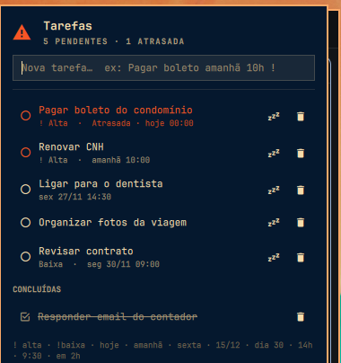

# Tarefas (logan.tarefas)

Lista de pendências na barra do Omarchy que **te cobra até você fazer**.




## Instalação

```
git clone https://github.com/LoganMerazzi/omarchy-tarefas ~/.config/omarchy/plugins/logan.tarefas
omarchy bar put logan.tarefas --section centerBegin --index 0
```

- Clique no contador da barra → painel; digite e Enter para adicionar.
- Clique numa tarefa para concluir (clique de novo em "Concluídas" para desfazer).
- 󰒲 adia, 󰆴 apaga. Cada tarefa tem um número limitado de adiamentos.

## Sintaxe rápida

`Pagar boleto amanhã 10h !` · `Comprar cimento sábado #obra` · `Ligar dentista sexta 14:30` · `Revisar contrato dia 30 !baixa` · `Mandar email em 2h`

- Prioridade: `!` / `!alta`, `!media`, `!baixa`
- Tags: `#obra`, `#empresa`… (saem do título; no painel, clique numa tag para filtrar — com filtro ativo, a tarefa nova já entra com a tag). Sincronizam como categorias (Tasks.org mostra e filtra).
- Data: `hoje`, `amanhã`, `segunda`…`domingo`, `15/12`, `dia 30`, `em 30min|2h|3d`
- Hora: `14h`, `14h30`, `9:30` (data sem hora = 9h)

## Cobrança

A cada minuto o widget roda `tarefas.py tick`:
- prazo chegou → notificação na hora; atrasada → repete a cada 30 min (crítica)
- sem atraso → a cada 60 min lembra a pendência mais importante: sem prazo, ou com prazo nas próximas 24h (tarefas com prazo distante ficam quietas)
- botões: Abrir lista · Adiar · Feito; esgotados os adiamentos, só resta fazer ou apagar
- silêncio das 22h às 8h

Intervalos, limite de adiamentos e horário de silêncio ficam nas configurações do widget.

## Sincronização (CalDAV)

Opcional. Com `~/.config/tarefas/caldav.env` presente, as tarefas viram VTODO
num servidor CalDAV (aqui, Radicale no CasaOS; veja `extras/bastion/`) e
aparecem em qualquer cliente: no Android, o Tasks.org.

```
CALDAV_URL=https://servidor/
CALDAV_USER=usuario
CALDAV_PASSWORD=...
CALDAV_COLLECTION=/usuario/tarefas/   # opcional
```

- A lista local continua sendo a fonte da cobrança: sem rede, nada muda; sincroniza quando o servidor voltar.
- Sincroniza logo após cada mudança e a cada 2 min. Manual: `python3 tarefas.py sync`.
- Conflito (mudou nos dois lados): vence a edição mais recente.
- Campos que outros apps põem na tarefa (categorias, etc.) são preservados.

## Boletos do Google Drive

Opcional. Com `~/.config/tarefas/boletos.conf`, a cada 30 min o plugin lê as
pastas de boletos (organizadas em `AAAA/MM`) e cria uma tarefa de pagamento
para cada boleto novo:

```
[pessoal]
pasta = ~/GoogleDrive/Finanças/Boletos

[empresa]
pasta = ~/GoogleDrive/Finanças/Empresa/Pagamentos
rotulo = empresa
```

- Vencimento e valor saem do código de barras (bancário ou de arrecadação, como DAS e DARF), do texto do PDF ou do nome do arquivo (`08 - Claro - Boleto.pdf` na pasta `2026/12`).
- Entra com as tags `#pagamento` e `#pessoal`/`#empresa` (nome da seção ou `rotulo`).
- A tarefa traz o link do Drive (abre no celular) e o código de barras. No painel, 󰈙 abre o PDF e 󰆏 copia o código.
- Um `Comprovante` com o mesmo nome conclui a tarefa.
- Arquivos duplicados (mesmo código de barras) viram uma tarefa só. Nomes com "não pagar" ou "gerada errada" são ignorados.
- PDFs protegidos: senhas em `~/.config/tarefas/pdf-senhas`, uma por linha (chmod 600). As senhas nunca aparecem na linha de comando.
- Na primeira execução só entram boletos a vencer. Depois, entram também os vencidos há até 15 dias.
- Manual: `python3 tarefas.py boletos -n` (só mostra) e `python3 tarefas.py boletos`.

## Terminal

```
python3 tarefas.py add "Pagar boleto amanhã 10h !"
python3 tarefas.py ls [#tag]
python3 tarefas.py tag <id> +obra -casa
python3 tarefas.py done <id>
```

Dados: `~/.local/share/tarefas/tarefas.json`.
