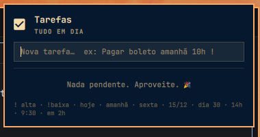

# Tarefas (logan.tarefas)

Lista de pendências na barra do Omarchy que **te cobra até você fazer**.




## Instalação

```
git clone https://github.com/LoganMerazzi/omarchy-tarefas ~/.config/omarchy/plugins/logan.tarefas
omarchy bar put logan.tarefas --section centerBegin --index 0
```

- Clique no contador da barra → painel; digite e Enter para adicionar.
- Clique numa tarefa para concluir (clique de novo em "Concluídas" para desfazer).
- 󰒲 adia, 󰆴 apaga. Cada tarefa tem um número limitado de adiamentos.

## Sintaxe rápida

`Pagar boleto amanhã 10h !` · `Ligar dentista sexta 14:30` · `Revisar contrato dia 30 !baixa` · `Mandar email em 2h`

- Prioridade: `!` / `!alta`, `!media`, `!baixa`
- Data: `hoje`, `amanhã`, `segunda`…`domingo`, `15/12`, `dia 30`, `em 30min|2h|3d`
- Hora: `14h`, `14h30`, `9:30` (data sem hora = 9h)

## Cobrança

A cada minuto o widget roda `tarefas.py tick`:
- prazo chegou → notificação na hora; atrasada → repete a cada 30 min (crítica)
- sem atraso → a cada 60 min lembra a pendência mais importante
- botões: Abrir lista · Adiar · Feito; esgotados os adiamentos, só resta fazer ou apagar
- silêncio das 22h às 8h

Intervalos, limite de adiamentos e horário de silêncio ficam nas configurações do widget.

## Terminal

```
python3 tarefas.py add "Pagar boleto amanhã 10h !"
python3 tarefas.py ls
python3 tarefas.py done <id>
```

Dados: `~/.local/share/tarefas/tarefas.json`.
